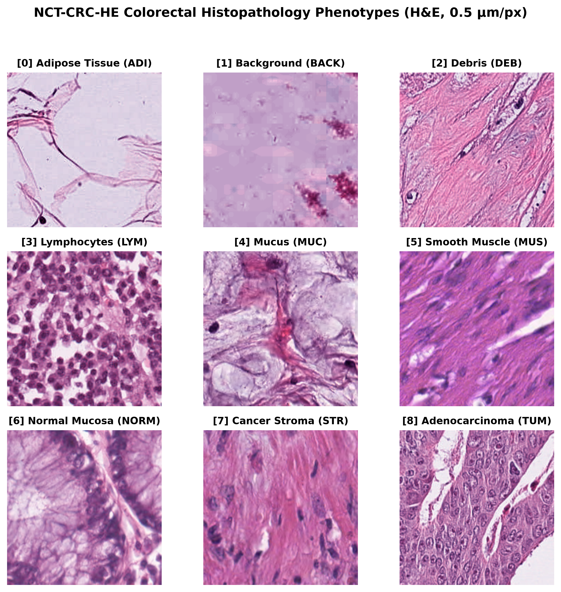
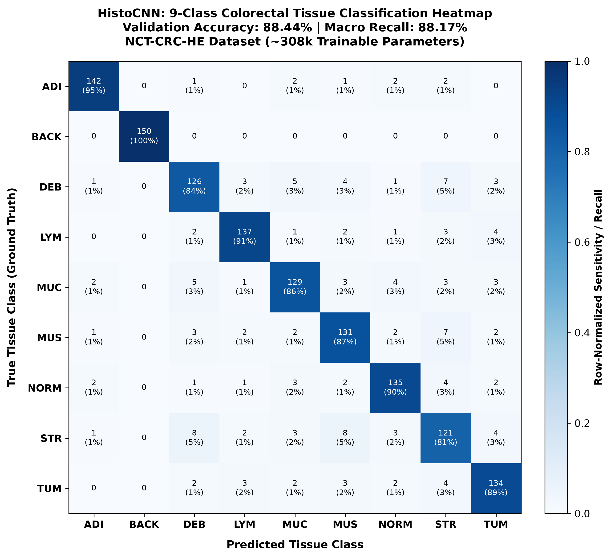

# HistoCNN: Colorectal Histopathology Tissue Classifier

[](https://www.python.org/)
[](https://pytorch.org/)
[](https://mlflow.org/)
[](LICENSE)
[](https://colab.research.google.com/github/abinayan-a7/colorectal-tissue-classifier/blob/main/notebooks/colab_training.ipynb)

A PyTorch project implementing **HistoCNN**, a custom 4 block Convolutional Neural Network built from scratch to classify colorectal cancer histopathology image patches into 9 tissue categories.

---

## Dataset & Tissue Classes

This project uses a balanced 9,000 image subset (1,000 patches per class, $64 \times 64$ RGB) streamed from the **NCT-CRC-HE** dataset (`1aurent/NCT-CRC-HE`), split 85% for training (7,650 patches) and 15% for validation (1,350 patches).

| Index | Code | Tissue Class | Description |
|:---:|:---:|:---|:---|
| `0` | **ADI** | Adipose | Fat tissue cells |
| `1` | **BACK** | Background | Empty slide background |
| `2` | **DEB** | Debris | Necrotic tissue fragments and cellular debris |
| `3` | **LYM** | Lymphocytes | Immune / inflammatory cell clusters |
| `4` | **MUC** | Mucus | Extracellular mucin pools |
| `5` | **MUS** | Smooth Muscle | Smooth muscle tissue layers |
| `6` | **NORM** | Normal Mucosa | Healthy colon crypts and epithelium |
| `7` | **STR** | Stroma | Cancer associated connective tissue |
| `8` | **TUM** | Tumor | Colorectal adenocarcinoma epithelium |

<p align="center">
  
</p>

---

## Model Architecture

Instead of fine tuning a large pretrained network like ResNet-50, **HistoCNN** is trained from scratch with 4 convolutional blocks and a lightweight dual-dropout classifier head:

- **Total Trainable Parameters:** 308,361 (`1.19 MB` checkpoint)
- **Data Augmentation:** Random horizontal and vertical flips ($p=0.5$)
- **Optimizer & Loss:** AdamW ($\text{weight decay}=10^{-4}$) with Cross-Entropy Loss
- **Classifier Regularization:** Dual spatial dropout ($p=0.4$ on input features, $p=0.2$ on hidden layer)

```text
Input Patch: (3, 64, 64)
    │
    ├── Block 1: Conv2d(3 -> 32, 3x3, pad=1) -> BatchNorm2d -> ReLU -> MaxPool2d(2, 2)        => (32, 32, 32)
    ├── Block 2: Conv2d(32 -> 64, 3x3, pad=1) -> BatchNorm2d -> ReLU -> MaxPool2d(2, 2)       => (64, 16, 16)
    ├── Block 3: Conv2d(64 -> 128, 3x3, pad=1) -> BatchNorm2d -> ReLU -> MaxPool2d(2, 2)      => (128, 8, 8)
    ├── Block 4: Conv2d(128 -> 128, 3x3, pad=1) -> BatchNorm2d -> ReLU -> AdaptiveAvgPool(2,2)=> (128, 2, 2)
    │
Flatten: 128 * 2 * 2 = 512 features
    │
    ├── Dropout(p=0.4)
    ├── Linear(512 -> 128) -> ReLU -> Dropout(p=0.2)
    └── Linear(128 -> 9)
    │
Output Logits: (N, 9)
```

---

## MLflow Hyperparameter Tuning

Hyperparameter optimization was tracked across multi-run experiments using **MLflow** in Google Colab (`came_assignment_02_tuning`):

| Run Name | Learning Rate | Epochs | Batch Size | LR Scheduler | Status |
|:---|:---:|:---:|:---:|:---:|:---:|
| `run_baseline_lr1e3_ep12_bs32` | $1.0 \times 10^{-3}$ | 12 | 32 | Constant | Baseline |
| `run_cosine_lr1e3_ep16_bs32` | $1.0 \times 10^{-3}$ | 16 | 32 | Cosine Annealing | Candidate |
| `run_cosine_lr7e4_ep18_bs32` | $7.0 \times 10^{-4}$ | 18 | 32 | Cosine Annealing | Candidate |
| **`run_bs64_lr12e3_ep16`** | **$1.2 \times 10^{-3}$** | **16** | **64** | **Cosine Annealing** | 🏆 **Winning Checkpoint** |

> **Winning Strategy (`run_bs64_lr12e3_ep16`)**: Scaling batch size to 64 combined with Cosine Annealing LR scheduling ($\text{lr}=1.2 \times 10^{-3}$, 16 epochs) produced smoother gradient steps and the highest validation macro recall.

---

## Results

Evaluated on the 1,350 image validation split using [`weights/histocnn_best.pth`](weights/histocnn_best.pth):

| Metric | Score |
|:---|:---:|
| **Validation Accuracy** | **88.44%** |
| **Macro Recall** | **88.17%** |

### Per-Class Recall
| Class | Recall | Correct / Total |
|:---|:---:|:---:|
| **ADI** | 94.67% | 142 / 150 |
| **BACK** | 100.00% | 150 / 150 |
| **DEB** | 84.00% | 126 / 150 |
| **LYM** | 91.33% | 137 / 150 |
| **MUC** | 86.00% | 129 / 150 |
| **MUS** | 87.33% | 131 / 150 |
| **NORM** | 90.00% | 135 / 150 |
| **STR** | 80.67% | 121 / 150 |
| **TUM** | 89.33% | 134 / 150 |

<p align="center">
  
</p>

---

## Project Structure

```text
colorectal-tissue-classifier/
├── assets/
│   ├── confusion_matrix.png # Validation confusion matrix heatmap
│   └── sample_patches.png   # 3x3 sample grid of the 9 tissue classes
├── notebooks/
│   └── colab_training.ipynb # Google Colab notebook with MLflow multi-run sweep
├── scripts/
│   ├── __init__.py
│   ├── plot_results.py      # Generates the confusion matrix plot
│   └── plot_samples.py      # Generates the 3x3 sample patch grid
├── src/
│   ├── __init__.py
│   ├── dataset.py           # Transforms, Hugging Face streaming, and DataLoaders
│   ├── evaluate.py          # Inference and evaluation metrics
│   ├── model.py             # HistoCNN architecture (dual-dropout head)
│   └── train.py             # Training loop with CosineAnnealingLR and checkpointing
├── weights/
│   └── histocnn_best.pth    # Trained winning model weights (1.19 MB)
├── .gitignore
├── LICENSE
├── requirements.txt
└── README.md
```

---

## How to Run

### 1. Setup
```bash
git clone https://github.com/abinayan-a7/colorectal-tissue-classifier.git
cd colorectal-tissue-classifier

python3 -m venv .venv
source .venv/bin/activate
pip install -r requirements.txt
```

### 2. Evaluate Pretrained Weights
```bash
python -m src.evaluate --weights weights/histocnn_best.pth
```

### 3. Train from Scratch
```bash
python -m src.train --epochs 16 --batch-size 64 --lr 0.0012 --use-cosine-lr --save-path weights/histocnn_custom.pth
```

### 4. Generate Plots
```bash
python -m scripts.plot_samples --save-path assets/sample_patches.png
python -m scripts.plot_results --save-path assets/confusion_matrix.png
```

---

## References
- **Dataset:** Kather, J. N., et al. (2018). *100,000 histological images of human colorectal cancer and healthy tissue.* Zenodo / Hugging Face (`1aurent/NCT-CRC-HE`).
- **License:** [MIT License](LICENSE)
